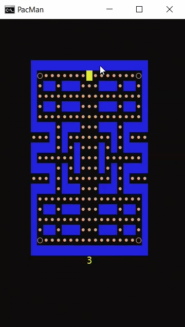

# How I make games in Batch Script, Part 2

## Introduction
This is the second part of my guide to making games in Batch Script ([part 1](https://github.com/thelowsunoverthemoon/BatchArticles/blob/main/HowIMakeGamesInBatchScriptP1.md)), and covers graphics: how to get colourful graphics in your games. However, some of these methods only apply to Windows 10+ as they rely on VT100 escape sequence support (specifically Windows 10 version 1511+. Note that 1511 didn't support true 24 bit RGB colours but still accepted the sequences, Conhost just rounded the colours to the original 16 colour palette; 24 bit "True Colour" support was added in 1703), but they would still work if using a terminal emulator that supports those sequences.

## Font

Changing the font can be useful when you have a custom font with sprites, for example. Font changing can be done by using the [REG](https://ss64.com/nt/reg.html) family of commands. These commands edit the registry, which contains configurations for the operating system, applications, and user preferences. Tangentially, these commands are quite useful for many of the annoying things in Windows. For example, disabling Cortana in Windows 10:

```Batch
REG ADD "HKLM\SOFTWARE\Policies\Microsoft\Windows\Windows Search" /V "AllowCortana" /T REG_DWORD /D "0" /F
```

There are requirements for the font used. For example, in Conhost, there are a list of requirements such as being monospace (full list [here]( https://renenyffenegger.ch/notes/Windows/dirs/Windows/System32/conhost_exe)). The overall technique is to add a ```Console``` registry key with the console title (in the example, it's GameEngine), start the process again with a parameter (so it gets the new font and skips creating the reg key) then delete the reg key so it doesn't affect other scripts if they have the same title. The specification for the key can be found [here](https://renenyffenegger.ch/notes/Windows/registry/tree/HKEY_CURRENT_USER/console/index). 

```Batch
@ECHO OFF
IF "%1" == "" (
    >NUL REG ADD HKCU\Console\GameEngine /v FaceName /t reg_sz /d "Lucida Console" /f
    START "GameEngine" "%~0" 1
    EXIT
) else ( >NUL REG DELETE HKCU\Console\GameEngine /f )

ECHO Hello, I'm in a different font^!
PAUSE
EXIT
```

In the code above, I only change the FaceName (the font family) to Lucida Console, a preinstalled console font, but you can also change aspects such as the font size. For example, IcarusLives made it into a function with more parameters ([source](https://github.com/IcarusLivesHF/Batch-Script-Projects/blob/cb7e5baea3f7deecb9c397939d5aec1343f0de1f/atom/atom.bat#L4)):

```Batch
:Set_Font FontName FontSize max/nomax dummy
if "%4"=="" (
  for /f "tokens=1,2 delims=x" %%a in ("%~2") do if "%%b"=="" (set /a "FontSize=%~2*65536") else set /a "FontSize=%%a+%%b*65536"
  reg add "HKCU\Console\%~nx0" /v FontSize /t reg_dword /d !FontSize! /f
  reg add "HKCU\Console\%~nx0" /v FaceName /t reg_sz /d "%~1" /f
  set "m=" & if /I "%~3"=="max" set "m=/max"
  start "%~nx0" !m! "%ComSpec%" /c "%~f0" _
  exit /b 1
) else ( >nul reg delete "HKCU\Console\%~nx0" /f )
goto:eof
```

You can also combine this with the multithreading techniques I showed in part 1. For example, in [Pacman](https://github.com/thelowsunoverthemoon/Arcade.bat/blob/master/Scripts/Pacman.bat), I use a specialized version of this. Instead of returning ```1``` I return ```Font```, so the other processes (```GAME``` and ```CONTROLLER```) won't go through the font setting.

```Batch
IF "%1" == "" (
    >NUL REG ADD HKCU\Console\PacMan /v FaceName /t REG_SZ /d "Lucida Console" /f
    START "PacMan" "%~0" Font
    EXIT
) else IF "%1" == "Font" (
    >NUL REG DELETE HKCU\Console\PacMan /f
) else (
    GOTO :%1
)
```



A fun example of this technique in a matrix script by neorobin [here](https://www.dostips.com/forum/viewtopic.php?f=3&t=3381&p=21402&hilit=matrix#p21402).

<Add matrix gif>
    
## VT100 Escape Sequences

VT100 escape sequence support allows for easy colour graphics in Batch Script: mainly, allowing for arbitrary cursor positioning and multiple colours in one console. Of course, there were ways to do this before VT100 support, but they were cumbersome and obscure.

### Before VT100

For example, the ```FINDSTR``` trick is famous for allowing multiple colours (see the answer by user jeb [here](https://stackoverflow.com/questions/4339649/how-to-have-multiple-colors-in-a-windows-batch-file)). The basic idea works by using the ```/A``` switch in ```FINDSTR``` which displays a filename in the same format as the ```COLOR``` command. The original idea created the file with the text as the filename with a single backspace character inside, so when you use ```FINDSTR``` to search for any non-empty lines, the colon character from the command output is erased with the backspace. For example, the below function by user ```jeb```

```Batch
:ColorText
echo off
<nul set /p ".=%DEL%" > "%~2"
findstr /v /a:%1 /R "^$" "%~2" nul
del "%~2" > nul 2>&1
goto :eof
```

To support all characters / sequences, there are various other improvements to this technique. For example, we can cleverly utilize ```\..\``` in the file created. Due to the file parsing rules, this means that the prefix is removed before being parsed as a filename so that means we don't have to create a new file everytime since it's always going to become ```X```, and also that we can support all characters since the prefix will be removed. Since the file path afterwards is a constant we can backspace everything except the string we want. See the below function, also by ```jeb```.

Creating the file:
```Batch
<nul > X set /p ".=."
```

The function:

```Batch
:color
set "param=^%~2" !
set "param=!param:"=\"!"
findstr /p /A:%1 "." "!param!\..\X" nul
<nul set /p ".=%DEL%%DEL%%DEL%%DEL%%DEL%%DEL%%DEL%"
exit /b
```

The downside to the ```FINDSTR``` technique is that it is quite slow and creates a temporary file, so a real time game with many colours at once would not work using this. Tangentially, the file name rules come in handy from time to time. For example, in [radish](https://github.com/thelowsunoverthemoon/radish), to allocate the ```CMDCMDLINE``` buffer to an arbitrary size, I use ```%COMSPEC%\\##############\\..\\..\\cmd.exe /k file.bat ```. Since the ```###``` is removed, I can add as many ```#``` as I want. 

For arbitrary cursor positioning, you could whip something up quickly by manipulating spaces and newlines. Not hard per say, but annoying since you would effectively be writing a 2D renderer. However, an interesting technique for arbitrary (but relative) cursor positioning involves exploiting the behaviour of tab and backspace sequences (see [here](https://www.dostips.com/forum/viewtopic.php?t=7898)).

### Prerequisites

Going back to VT100 escape sequences, in earlier versions of Windows 10 you had to enable ```VirtualTerminalLevel``` to 1 in ```HKEY_CURRENT_USER\CONSOLE```. This would involve the same ```REG``` technique that we saw in the [Font](#Font) section. The basic format of a sequence is just having the escape character as a prefix, followed by some sequence of characters. 

The first part is actually getting the escape character. There are many ways to do it. You can either do it "literally", as in you just copy and paste the escape character. In Notepad++ it typically shows up as a empty box character. However, the downside compared to doing it programmatically is that it may get lost when sharing through different file formats and modes, and it can get annoying to keep copy pasting every time. An easier way is to just derive it programmatically. One of the earlier ways to do it was:

```Batch
FOR /F "tokens=1,2 delims=#" %%A in ('"PROMPT #H#E# & ECHO ON & FOR %%B in (1) DO REM"') DO (
    SET "\e=%%B"
) 
```

```PROMPT``` changes the text that you see before every line on a normal command prompt. Ie, the default is the path followed by >. So, in the ```PROMPT``` command, you are setting it to ```#(backspace)#(escape character)#```. Normally, you have ```ECHO OFF```, so you don't see this text before every command. That's why in the next command you set ```ECHO ON```, so you can see the text you just set with ```PROMPT``` (and parse it using ```FOR /F```). Now, the ```FOR %%B in (1) DO REM``` is pretty clever. You need to do a command to trigger the ```PROMPT``` text, with no output with newlines on its own. Thus, you can use ```REM```, which is for comments. But why the ```FOR```? That's because anything after ```REM``` will be treated as a comment (which would cause an error left alone). The ```FOR``` "implies" parenthesis that is functionally equivalent to

```Batch
FOR %%B in (1) DO (
    REM
)
```

Tangentially, that ```REM``` behavior can be exploited when you want to get everything up to the first delimiter in the string. For example:

```Batch
SET "head=%str:x=" & REM."%"
```

By inserting a ```REM``` in place of the delimiter, the rest of the string is treated as a comment and isn't ```SET```, since percent variable expansion is done first before interpreting the commands. For more information on the parser, read [this](https://stackoverflow.com/questions/4094699/how-does-the-windows-command-interpreter-cmd-exe-parse-scripts). Finally, we use ```FOR /F``` to parse the generated text ```PROMPT``` text through the ```REM``` command. So why did we use ```#H#E#``` instead of ```#E```? Actually, you could have. But in this case, now you can also get the backspace character (the chars are separated by #) if you put

```Batch
SET "\b=%%A"
```

inside the loop. User Aacini refined this to just 

```Batch
FOR /F %%A in ('ECHO PROMPT $E^| CMD') DO SET "\e=%%A"
```

By passing in ```PROMPT $E``` to ```CMD``` we start a new CMD session and run the ```PROMPT``` command. ```CMD``` defaults with ```ECHO ON``` and so it becomes the same thing as before. The reason the previous text isn't detected for both those techniques (eg. the text of the ```PROMPT``` command) is because a newline is also a delimiter so it at first sets ```\e``` to those strings, and in the final loop sets it to the correct escape character.


### Using Sequences

To use the sequences, all you have to do is print to ```stdout```, for example using ```ECHO``` or ```<NUL SET /P```. Explaining all of the sequences would be pretty useless since they are quite straightforward. A good guide to all of them is in the Microsoft [documentation](https://learn.microsoft.com/en-us/windows/console/console-virtual-terminal-sequences). So, I'll only go through some of the most important ones and some tips / tricks, and refer to them by their name in the "Description" column. For common sequences, I typically use macros so I don't have to type the full sequence all over again. For example, I'll typically have a ```MACROS``` function I call at the beginning of the script which sets macros. However, this is completely optional, it just saves typing.

```Batch
SET "col=%\e%[38;2;cm"
SET "bcl=%\e%[48;2;cm"
SET "up=%\e%[nA"
SET "dn=%\e%[nB"
SET "bk=%\e%[nD"
SET "nx=%\e%[nC"
```

To use, just use string substitution. For example, setting the colour to ```46;40;36```:

```Batch
%col:c=46;40;36%
```

Just remember that these sequences are literally just text. In fact, everything in Batch Script is interpreted as text (strings), which is useful when examining some of the more interesting tricks in Batch Script such as [Command Substitution](https://www.dostips.com/forum/viewtopic.php?f=3&t=6429). Thus, a "sprite" is just saving these sequences into a variable; and this extends very naturally into creating animations, character movement, etc. For example, here is a sprite of the first frame of an idle Peashooter from my Plants vs Zombies [clone](https://github.com/thelowsunoverthemoon/Arcade.bat/blob/master/Scripts/PlantsVsZombies.bat).

```Batch
SET "peashoot#0=%col:c=130;221;99%%bk:n=1%_│_%up:n=1%%bk:n=2%│%up:n=1%%bk:n=1%%bcl:c=153;224;150%%col:c=0;0;0%•%\e%[0m%col:c=130;221;99%▄"
```

<Add peashooter image>
    
### Clearing

Clearing the screen can be achieved using the ```Erase Character```, ```Erase in Line```, and ```Erase in Display``` sequences. The other ones insert or delete lines / spaces, which can be used for some neat text effects, but not too useful otherwise. For example, ```Insert Line``` can be used to create a Star Wars intro text effect. The important thing to remember for the erase sequences is that they basically overwrite the specified area with spaces. Thus, instead of always doing

```Batch
%\e%[2J
```

For larger screens on slower computers, this can cause a noticeable flicker as the spaces are written. To counteract this, you can 1) use the ```MODE``` command to control how big the console is. However, note this is not currently supported in Terminal, only Conhost. and 2) only erase the sections you need. For example, in a platformer game, you might have user stats at the bottom, and the actual game at the top. You can then do a partial clear, eg if the actual game ends at position ```11, 11```:

```Batch
%\e%[11;11H%\e%[1J
```

And just overwrite the user stats when they actually change. This technique can be found in my platformer, [Momodora: Lunar Glow](https://github.com/thelowsunoverthemoon/MomodoraLunarGlow/blob/main/game.bat). The below code prints a title screen, while the bottom contains a separate process that prints an animated border.

```Batch
ECHO %ESC%[21;60H%ESC%[1J ^
             !par.disp! ^
             %ESC%[2;4HLowsun 2025 ^
             %ESC%[10;23H┳┳┓        ┓%ESC%[1B%ESC%[12D┃┃┃┏┓┏┳┓┏┓┏┫┏┓┏┓┏┓%ESC%[1B%ESC%[18D┛ ┗┗┛┛┗┗┗┛┗┻┗┛┛ ┗┻ ^
             %ESC%[1B%ESC%[30D%ESC%[38;2;129;197;240m♦︎%ESC%[0m%ESC%[1m Lunar Glow %ESC%[0m%ESC%[38;2;129;197;240m♦︎%ESC%[0m ^
             %ESC%[15;27HSelect (A^)
```


Sometimes it's just easier to just overwrite characters. For example, in my game [Rainy Day Teeko](https://github.com/thelowsunoverthemoon/Games.bat/blob/main/RainyDayTeeko/RainyDayTeeko.bat), my rain animation just overwrites the previous position with a space. Technically, I could also use the "Erase Character" sequence but that would be unnecessary since it's only 1 character. If for example the particles were really wide than using that sequence could save on string size. It's in a compact macro form because I use it in many places in that game:

```Batch
SET $rain=SET "rain.cpy=^!rain.par^!" ^& SET "rain.par=" ^& SET "rain=" ^& FOR %%R in (^^!rain.cpy^^!) DO (FOR /F "tokens=1-3" %%1 in ("%%~R") DO (SET /A "rain.y=%%2 + 1" ^& SET "rain=^!rain^!%\e%[%%2;%%1H%up:n=1% " ^& IF not "^!rain.y^!" == "39" (SET "rain=^!rain^!%\e%[%%2;%%1H%%3" ^& SET rain.par=^^^!rain.par^^^! "%%1 ^!rain.y^! %%3")))
```

It works by returning a rain sprite into ```rain```. ```rain.par``` contains a list of rain particles with positions, and for each of them we increase the y position and use the positioning sequences write a space character at the previous position. If the rain particle is still valid, we then write the rain sprite. That way we don't have to use any more ```SET /A``` statements. Using it would then be something like this:

```Batch
SET /A "add.rain=frame %% 9"
ECHO.!rain!
%$rain%
IF "!add.rain!" == "0" (
    SET /A "rain.x=!RANDOM! %% 70", "rain.type=!RANDOM! %% 2"
    IF "!rain.type!" == "0" (
        SET "rain.par=!rain.par! "!rain.x! 1 %col:c=74;101;131%.""
    ) else (
        SET "rain.par=!rain.par! "!rain.x! 1 %col:c=108;128;148%^│""
    )
)
```

<Add rain gif>
    
Finally, this is only somewhat related to erasing, but I like the hide the cursor in games so that you don't see the cursor bouncing around all the time. I usually just ```ECHO``` the "Text Cursor Enable Mode Hide" sequence.

```Batch
ECHO %\e%[?25l
```

### Colours

### Positioning

## Sixels
## Code Pages
